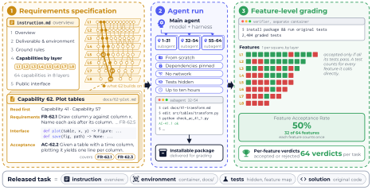

<p align="right"><b>English</b> · <a href="README.zh-CN.md">中文</a></p>

<p align="center">
  <picture>
    <source media="(prefers-color-scheme: dark)" srcset="assets/brand/tokenwave-dark.svg">
    
  </picture>
</p>

# NL2Repo-Pro

<p align="center">
  <a href="https://tokenwave-ai.github.io/NL2Repo-Pro/"> Blog</a> ·
   Paper (soon) ·
  <a href="https://huggingface.co/datasets/Tokenwave-AI/NL2Repo-Pro"> Dataset</a> ·
  <a href="#quick-start">Quick start</a> ·
  <a href="README.zh-CN.md">中文</a>
</p>

NL2Repo-Pro is a benchmark for coding agents building production-scale libraries from scratch. Each task gives the agent the layered requirements documents of a real library: an overview, then one specification per feature, ordered by dependency. The agent writes the whole library, and the library's original tests grade the result feature by feature.

The benchmark has 150 tasks in Python, Go, Rust, Java and JavaScript. The median library has 74K lines of source.

<p align="center"></p>
<p align="center"><sub>A task and its grading. A test counts for every feature it calls directly, and a feature is accepted only when all of its tests pass: here 87% of the graded tests pass, yet only 32 of 64 features are accepted. The example is illustrative, and task files call a feature a capability and a layer a group.</sub></p>

This repository holds the Harbor configs of the systems we evaluated, a script to download the tasks, a script to summarize the results, and the project page (`docs/`). The tasks, with their grading code, are on [Hugging Face](https://huggingface.co/datasets/Tokenwave-AI/NL2Repo-Pro). Every task is a standard [Harbor](https://github.com/laude-institute/harbor) task directory.

## Results

Feature score, the share of a library's features whose tests all pass, on 150 tasks with one run per system. All features counts the tasks with every feature accepted.

| System | Harness | Feature score | Test pass rate | All features | Python | Go | Rust | Java | JavaScript |
|---|---|--:|--:|--:|--:|--:|--:|--:|--:|
| Claude Opus 5.5 | Claude Code 2.1.311 | **61.7** | 87.2 | 7 | 58.9 | 57.6 | 59.2 | 61.0 | 78.6 |
| GPT-6.1 Sol | Codex CLI 0.164.0 | **47.1** | 81.8 | 0 | 39.6 | 49.7 | 49.9 | 43.2 | 71.7 |
| DeepSeek V4.1 Flash | Claude Code 2.1.311 | **37.7** | 73.5 | 0 | 31.5 | 43.4 | 35.0 | 32.9 | 61.5 |
| Grok 4.7 | Claude Code 2.1.311 | **22.5** | 51.4 | 0 | 15.5 | 25.1 | 18.5 | 23.3 | 47.4 |

Every system ran with reasoning effort xhigh. The scores of every task are in [`results/paper-v1.tsv`](results/paper-v1.tsv).

## Setup

You need a Linux x86-64 machine with Docker, Python 3.12, `zstd` and two Python packages:

```bash
pip install harbor==0.23.0 "huggingface_hub[cli]"
git clone https://github.com/TokenWave-AI/NL2Repo-Pro.git
cd NL2Repo-Pro
```

Harbor 0.23.0 is the version our runs used. Each task runs in two containers, one for the agent and one for grading, and each container gets 4 CPU cores, 32 GB of memory and 64 GB of disk. All 150 tasks take 4.3 GB of task archives and 83 GB of image archives. The largest image archive is 4.7 GB.

## Quick start

Fetch one small task and check it. The reference solution scores 1.0 and an empty answer scores 0.

```bash
scripts/fetch.sh GroophyLifefor__heap-analysis__92eebf4
harbor run -p NL2Repo-Pro/run/GroophyLifefor__heap-analysis__92eebf4 -a oracle -y -o jobs
harbor run -p NL2Repo-Pro/run/GroophyLifefor__heap-analysis__92eebf4 -a nop -y -o jobs
python scripts/summarize.py jobs
```

`fetch.sh` downloads the task and its two Docker images, checks them against `SHA256SUMS`, unpacks the task into `NL2Repo-Pro/run/` and loads the images. It also takes a language (`scripts/fetch.sh python`) or `all`. The images are not in any registry. `docker load` gives them the local names that `task.toml` uses. Keep the names and `task.toml` as they are, since a changed task is not the task scored here.

A few tests are sensitive to machine load. If the reference solution scores below 1.0 when many tasks run at once, run fewer at a time with `-n`, for instance `-n 1`.

## Running an agent

`configs/` holds one Harbor job config for each system in the table, with the settings below.

```bash
# Claude Opus 5.5 in Claude Code
export ANTHROPIC_API_KEY=...
harbor run -c configs/claude-opus-5-5.yaml -p NL2Repo-Pro/run/<instance_id>

# GPT-6.1 Sol in Codex
unset CODEX_FORCE_AUTH_JSON CODEX_AUTH_JSON_PATH
export OPENAI_API_KEY=...
harbor run -c configs/gpt-6.1-sol.yaml -p NL2Repo-Pro/run/<instance_id>
```

Pass `-p NL2Repo-Pro/run` to run every fetched task, and `-n` to run several at a time. Harbor writes the results to `jobs/`, and `python scripts/summarize.py jobs` turns them into the table above, next to our systems on the same tasks. Add `--print-config` to see the full settings without running.

To use another endpoint, export its base URL and allow its host:

```bash
export ANTHROPIC_BASE_URL=https://gateway.example.com
harbor run -c configs/claude-opus-5-5.yaml -p NL2Repo-Pro/run --allow-agent-host gateway.example.com
```

Claude Code adds `/v1/messages` to its base URL, so give it the root of the endpoint. Codex adds `/responses`, so `OPENAI_BASE_URL` ends in `/v1`. The configs for DeepSeek V4.1 Flash and Grok 4.7 run those models in Claude Code, so they need an endpoint that serves them through the Anthropic Messages API.

To test another model, copy the closest config and change `model_name` and the two alias variables, `ANTHROPIC_DEFAULT_FABLE_MODEL` and `ANTHROPIC_SMALL_FAST_MODEL`. Set the model in the config. With `-c`, Harbor ignores `-m` unless `-a` is also given, and `-a` replaces the agent of the config.

| Setting | Claude Code | Codex CLI |
|---|---|---|
| Harness version | 2.1.311 | 0.164.0 |
| Reasoning effort | xhigh | xhigh |
| Web search and web fetch | off | off |
| Model | every model alias points to the tested model | the tested model |
| Context window | from the `[1m]` model name for Claude Opus 5.5, `CLAUDE_CODE_MAX_CONTEXT_TOKENS` for other models | `model_context_window`, 1,050,000 |
| Model fallback | off for models other than Claude | none |
| Background subagents | no wait ceiling, so they finish before the run ends | — |
| Network while answering | the model endpoint only | the model endpoint only |
| Time limit | 10 hours | 10 hours |

For comparable results:

- Keep web search and web fetch off. Some model gateways run Claude Code's WebSearch on the server, outside the container's network rule.
- For a model other than Claude in Claude Code, keep `CLAUDE_CODE_NO_MODEL_FALLBACK=1` so that no Claude model stands in for it, and set `CLAUDE_CODE_MAX_CONTEXT_TOKENS` to its context window.
- Unset `CODEX_FORCE_AUTH_JSON` and `CODEX_AUTH_JSON_PATH` before running Codex. With either set, Harbor uploads a local Codex login instead of the API key, and a login needs `auth.openai.com`, which the network rule blocks.
- Pass nothing but secrets in variables whose names contain `KEY`, `TOKEN`, `SECRET`, `PASSWORD`, `CREDENTIAL` or `AUTH`. Harbor treats their values as secrets and replaces every occurrence of them in the trial's files, results and code included.
- Count one run per task. Run a task again when its trial ends in an error outside the agent, such as an API error or a container failure. `summarize.py` leaves trials without a score out and reports how many there were.

## Scoring

The documents of each task split the library into features. A feature is accepted when all of its graded tests pass. The reward of a run is the share of features accepted, from 0 to 1. The verifier writes it to `jobs/<job>/<trial>/verifier/reward.json`. Next to it, `score.json` holds the test pass rate (`test_pass_ratio`) and, for every feature, its passed and total tests. Grading has 6.5 hours. Tests stop after 6 hours, and tests not reached by then count as failed.

## License

The code in this repository is under the [Apache License 2.0](LICENSE). Each task keeps the license of its source repository, named in its `task.toml`. See the [dataset card](https://huggingface.co/datasets/Tokenwave-AI/NL2Repo-Pro) for details.

## Citation

Coming with the arXiv version.
