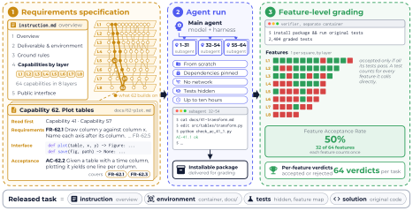

<p align="right"><a href="README.md">English</a> · <b>中文</b></p>

<p align="center">
  <picture>
    <source media="(prefers-color-scheme: dark)" srcset="assets/brand/tokenwave-dark.svg">
    
  </picture>
</p>

# NL2Repo-Pro

<p align="center">
  <a href="https://tokenwave-ai.github.io/NL2Repo-Pro/"> 博客</a> ·
   论文（即将发布） ·
  <a href="https://huggingface.co/datasets/Tokenwave-AI/NL2Repo-Pro"> 数据集</a> ·
  <a href="#快速开始">快速开始</a> ·
  <a href="README.md">English</a>
</p>

NL2Repo-Pro 是一个评测编程 agent 从零构建生产级规模代码库的基准。每道题给 agent 一套真实代码库的分层需求文档：先是一份总览，再是每个 feature 一份规格，按依赖关系排序。agent 写出整个库，再由这个库原有的测试逐个 feature 评分。

基准共 150 道题，覆盖 Python、Go、Rust、Java 和 JavaScript。代码库源码行数的中位数是 74K 行。

<p align="center"></p>
<p align="center"><sub>一道题及其评分方式。一个测试计入它直接调用的每个 feature，一个 feature 的测试全部通过才算被接受：图中 87% 的计分测试通过，但 64 个 feature 中只有 32 个被接受。图中的例子仅作示意。题目文件里把 feature 称为 capability，把层称为 group。</sub></p>

本仓库包含我们评测过的各系统的 Harbor 配置、一个下载题目的脚本、一个汇总结果的脚本，以及项目主页（`docs/`）。题目及其评分代码放在 [Hugging Face](https://huggingface.co/datasets/Tokenwave-AI/NL2Repo-Pro) 上。每道题都是标准的 [Harbor](https://github.com/laude-institute/harbor) 题目目录。

## 结果

Feature 得分指一个库中测试全部通过的 feature 所占的比例。下表是 150 道题上的结果，每个系统每道题跑一次。全部 feature 一栏统计所有 feature 都通过的题数。

| 系统 | Harness | Feature 得分 | 测试通过率 | 全部 feature | Python | Go | Rust | Java | JavaScript |
|---|---|--:|--:|--:|--:|--:|--:|--:|--:|
| Claude Opus 5.5 | Claude Code 2.1.311 | **61.7** | 87.2 | 7 | 58.9 | 57.6 | 59.2 | 61.0 | 78.6 |
| GPT-6.1 Sol | Codex CLI 0.164.0 | **47.1** | 81.8 | 0 | 39.6 | 49.7 | 49.9 | 43.2 | 71.7 |
| DeepSeek V4.1 Flash | Claude Code 2.1.311 | **37.7** | 73.5 | 0 | 31.5 | 43.4 | 35.0 | 32.9 | 61.5 |
| Grok 4.7 | Claude Code 2.1.311 | **22.5** | 51.4 | 0 | 15.5 | 25.1 | 18.5 | 23.3 | 47.4 |

所有系统的推理强度（reasoning effort）都设为 xhigh。每道题的分数见 [`results/paper-v1.tsv`](results/paper-v1.tsv)。

## 环境准备

需要一台装有 Docker、Python 3.12 和 `zstd` 的 Linux x86-64 机器，以及两个 Python 包：

```bash
pip install harbor==0.23.0 "huggingface_hub[cli]"
git clone https://github.com/TokenWave-AI/NL2Repo-Pro.git
cd NL2Repo-Pro
```

我们的运行使用的是 Harbor 0.23.0。每道题在两个容器里运行，一个给 agent，一个用于评分，每个容器分配 4 个 CPU 核、32 GB 内存和 64 GB 磁盘。150 道题的题目压缩包共 4.3 GB，镜像压缩包共 83 GB，最大的一个镜像压缩包是 4.7 GB。

## 快速开始

先下载一道小题并检查环境。参考答案应得 1.0 分，空答案应得 0 分。

```bash
scripts/fetch.sh GroophyLifefor__heap-analysis__92eebf4
harbor run -p NL2Repo-Pro/run/GroophyLifefor__heap-analysis__92eebf4 -a oracle -y -o jobs
harbor run -p NL2Repo-Pro/run/GroophyLifefor__heap-analysis__92eebf4 -a nop -y -o jobs
python scripts/summarize.py jobs
```

`fetch.sh` 会下载题目及其两个 Docker 镜像，用 `SHA256SUMS` 校验，把题目解压到 `NL2Repo-Pro/run/`，再加载镜像。参数也可以是一种语言（`scripts/fetch.sh python`）或 `all`。镜像没有发布到任何镜像仓库，`docker load` 会给它们加上 `task.toml` 里使用的本地名称。请保持镜像名称和 `task.toml` 不变，改动过的题目就不再是这里计分的题目。

少数测试对机器负载敏感。同时运行很多题时，如果参考答案没有得到 1.0，请用 `-n` 降低并发再跑，例如 `-n 1`。

## 运行 agent

`configs/` 里为表中每个系统各放了一份 Harbor job 配置，设置见下文。

```bash
# 在 Claude Code 中运行 Claude Opus 5.5
export ANTHROPIC_API_KEY=...
harbor run -c configs/claude-opus-5-5.yaml -p NL2Repo-Pro/run/<instance_id>

# 在 Codex 中运行 GPT-6.1 Sol
unset CODEX_FORCE_AUTH_JSON CODEX_AUTH_JSON_PATH
export OPENAI_API_KEY=...
harbor run -c configs/gpt-6.1-sol.yaml -p NL2Repo-Pro/run/<instance_id>
```

传入 `-p NL2Repo-Pro/run` 会运行所有已下载的题目，`-n` 设置同时运行的数量。Harbor 把结果写到 `jobs/`，`python scripts/summarize.py jobs` 会把结果整理成上面的表格，并列出我们的系统在相同题目上的分数。加上 `--print-config` 可以只查看完整设置而不运行。

如果使用其他 endpoint，导出它的 base URL 并放行它的主机：

```bash
export ANTHROPIC_BASE_URL=https://gateway.example.com
harbor run -c configs/claude-opus-5-5.yaml -p NL2Repo-Pro/run --allow-agent-host gateway.example.com
```

Claude Code 会在 base URL 后面加上 `/v1/messages`，所以要填 endpoint 的根地址。Codex 会加上 `/responses`，所以 `OPENAI_BASE_URL` 以 `/v1` 结尾。DeepSeek V4.1 Flash 和 Grok 4.7 的配置是在 Claude Code 中运行这两个模型，因此需要一个通过 Anthropic Messages API 提供它们的 endpoint。

要测试其他模型，复制最接近的配置，修改 `model_name` 和两个别名变量 `ANTHROPIC_DEFAULT_FABLE_MODEL`、`ANTHROPIC_SMALL_FAST_MODEL`。模型要在配置里设置：使用 `-c` 时，除非同时给出 `-a`，Harbor 会忽略 `-m`，而 `-a` 会替换配置里的 agent。

| 设置 | Claude Code | Codex CLI |
|---|---|---|
| Harness 版本 | 2.1.311 | 0.164.0 |
| 推理强度 | xhigh | xhigh |
| 网页搜索和网页抓取 | 关闭 | 关闭 |
| 模型 | 所有模型别名都指向被测模型 | 被测模型 |
| 上下文窗口 | Claude Opus 5.5 由模型名中的 `[1m]` 决定，其他模型由 `CLAUDE_CODE_MAX_CONTEXT_TOKENS` 决定 | `model_context_window`，1,050,000 |
| 模型回退 | 非 Claude 模型关闭 | 无 |
| 后台 subagent | 不设等待上限，确保在运行结束前完成 | — |
| 作答期间的网络 | 仅限模型 endpoint | 仅限模型 endpoint |
| 时间限制 | 10 小时 | 10 小时 |

为了让结果可比：

- 保持网页搜索和网页抓取关闭。有些模型网关会在服务端执行 Claude Code 的 WebSearch，绕过容器的网络规则。
- 在 Claude Code 中运行非 Claude 模型时，保留 `CLAUDE_CODE_NO_MODEL_FALLBACK=1`，避免由 Claude 模型代替它作答，并把 `CLAUDE_CODE_MAX_CONTEXT_TOKENS` 设为该模型的上下文窗口。
- 运行 Codex 前先 unset `CODEX_FORCE_AUTH_JSON` 和 `CODEX_AUTH_JSON_PATH`。只要设置了其中一个，Harbor 就会上传本地的 Codex 登录信息而不是 API key，而登录需要访问 `auth.openai.com`，会被网络规则拦截。
- 名称中含有 `KEY`、`TOKEN`、`SECRET`、`PASSWORD`、`CREDENTIAL` 或 `AUTH` 的变量只用来传密钥。Harbor 会把这些变量的值当作密钥，在 trial 的所有文件中替换掉，结果和代码也包括在内。
- 每道题只计一次运行。如果 trial 因 agent 之外的错误结束，比如 API 错误或容器故障，就重跑这道题。`summarize.py` 会排除没有分数的 trial，并报告排除了几个。

## 评分

每道题的文档把代码库划分为若干 feature。一个 feature 的所有计分测试都通过时，这个 feature 才被接受。一次运行的 reward 是被接受的 feature 所占的比例，取值 0 到 1。verifier 把它写到 `jobs/<job>/<trial>/verifier/reward.json`。同目录下的 `score.json` 记录测试通过率（`test_pass_ratio`），以及每个 feature 通过的测试数和测试总数。评分限时 6.5 小时。测试在 6 小时后停止，届时还没运行到的测试按失败计。

## 许可证

本仓库的代码采用 [Apache License 2.0](LICENSE)。每道题沿用其来源仓库的许可证，写在该题的 `task.toml` 里。详见[数据集卡片](https://huggingface.co/datasets/Tokenwave-AI/NL2Repo-Pro)。

## 引用

arXiv 版本发布后补充。
